# Omarchy Nothing Theme

A Nothing OS inspired theme for [Omarchy](https://omarchy.org): charcoal surfaces, warm white text, and restrained red accents. Dot-matrix lettering and the geometry of the Glyph interface.

Includes ten wallpapers adapted from **[NThing UI](https://github.com/Runixe786/NThing-UI) by [Runixe786](https://github.com/Runixe786)**.

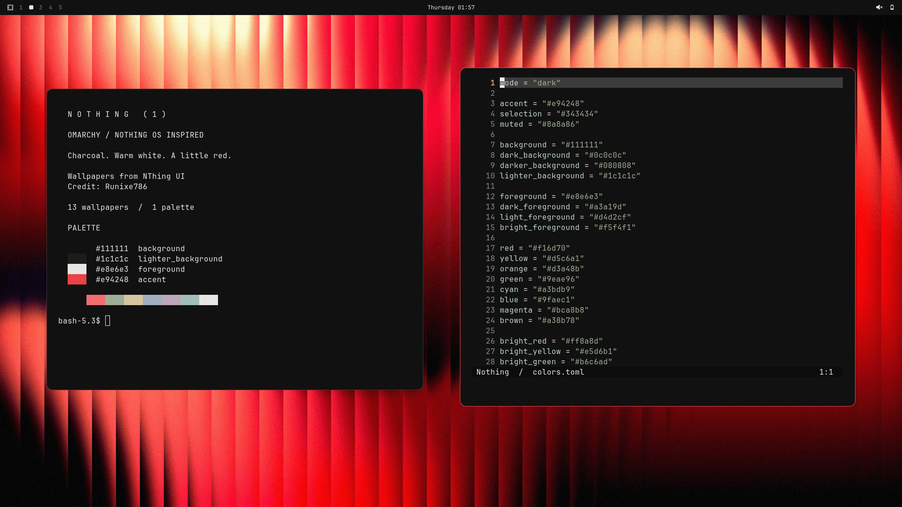

## Install

```sh
omarchy theme install https://github.com/Ninnix/omarchy-nthing-theme
```

Cycle wallpapers with `omarchy theme bg next`.

## Screenshots

Eight real desktop captures, with different wallpapers, applications, and window layouts. Click a preview for the full 1920×1080 capture.

<table>
<tr><td width="50%" align="center"><a href="screenshots/02-menu.png">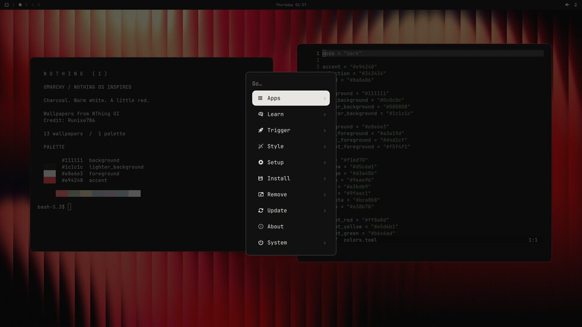</a><br><strong>Omarchy menu</strong><br><sub>White selection on charcoal</sub></td><td width="50%" align="center"><a href="screenshots/03-red-glyph.png">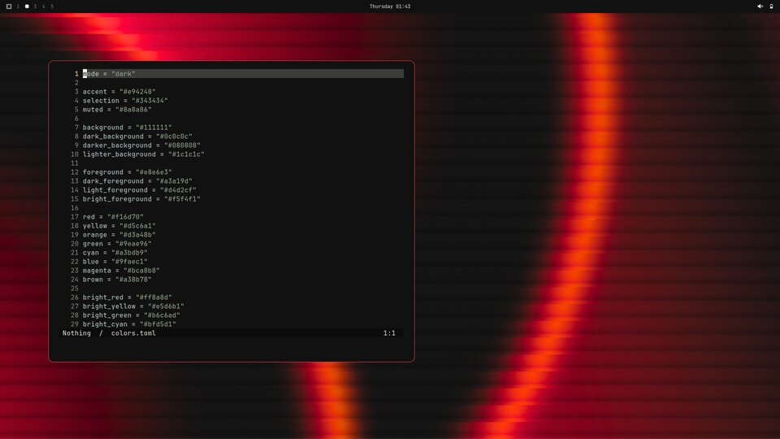</a><br><strong>Red Glyph</strong><br><sub>One editor, open desktop</sub></td></tr>
<tr><td width="50%" align="center"><a href="screenshots/04-carbon.png">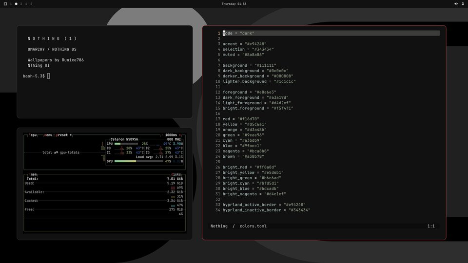</a><br><strong>Graphite</strong><br><sub>Terminal, Neovim, and btop</sub></td><td width="50%" align="center"><a href="screenshots/05-glyph.png">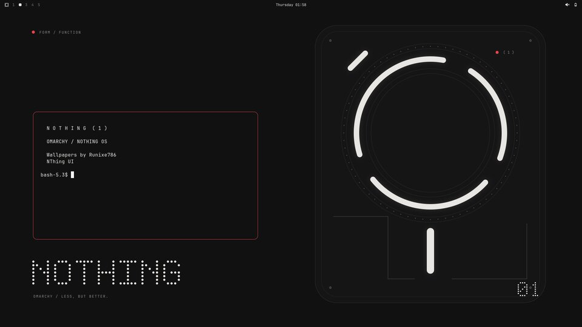</a><br><strong>Glyph</strong><br><sub>A small terminal beside the light segments</sub></td></tr>
<tr><td width="50%" align="center"><a href="screenshots/06-matrix.png">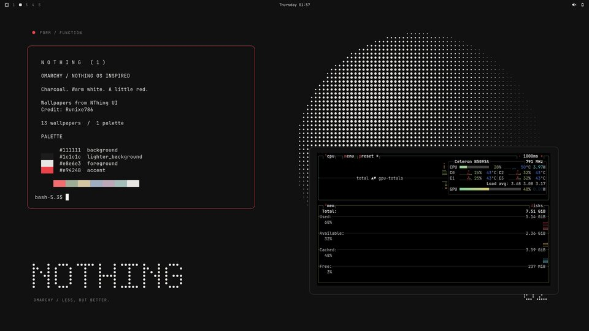</a><br><strong>Matrix</strong><br><sub>Terminal and system monitor</sub></td><td width="50%" align="center"><a href="screenshots/07-paper.png">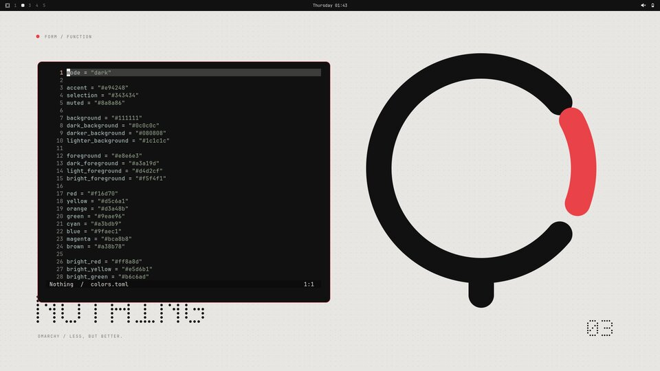</a><br><strong>Paper</strong><br><sub>One editor on warm white</sub></td></tr>
<tr><td width="50%" align="center"><a href="screenshots/08-monitor.png">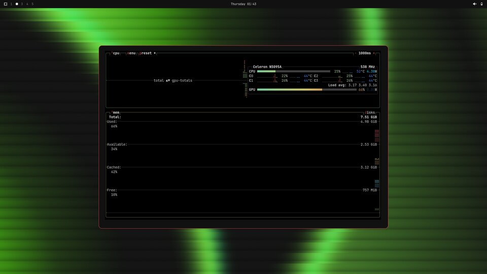</a><br><strong>Green Glyph</strong><br><sub>A single btop window</sub></td><td width="50%"></td></tr>
</table>

Captured in an isolated Hyprland session running the Omarchy shell, Foot, Neovim with the generated Aether palette, and btop. Window spacing and corner radius are local presentation settings; the theme keeps your own Hyprland layout.

## Wallpapers

Ten wallpapers from **[NThing UI by Runixe786](https://github.com/Runixe786/NThing-UI/tree/main/%40Resources/Wallpapers)**. Click any preview for the installable wallpaper. Desktop exports are opaque JPEGs, at most 3840×2160, without upscaling. Red Ripple is selected first.

<table>
<tr><td width="50%" align="center"><a href="backgrounds/00-nthing-001-1.jpg">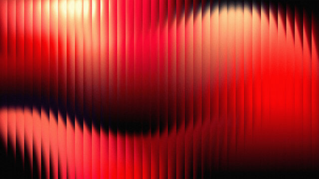</a><br><strong>Red Ripple</strong></td><td width="50%" align="center"><a href="backgrounds/00-nthing-002-10.jpg">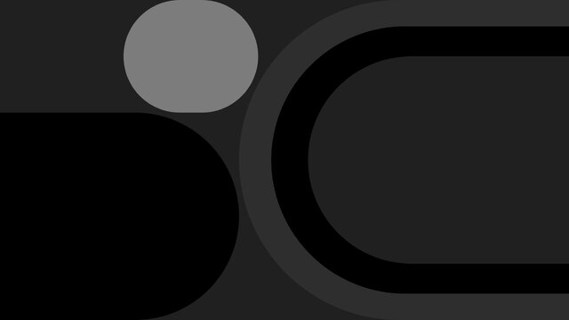</a><br><strong>Graphite Glyph</strong></td></tr>
<tr><td width="50%" align="center"><a href="backgrounds/00-nthing-003-2.jpg">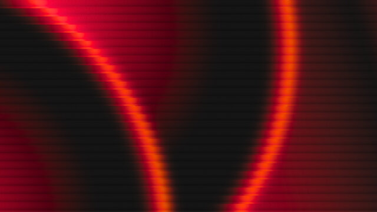</a><br><strong>Red Glyph</strong></td><td width="50%" align="center"><a href="backgrounds/00-nthing-004-3.jpg">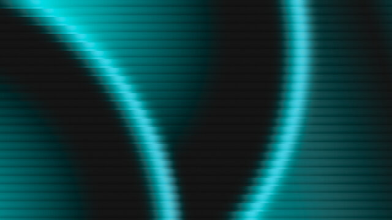</a><br><strong>Cyan Glyph</strong></td></tr>
<tr><td width="50%" align="center"><a href="backgrounds/00-nthing-005-4.jpg">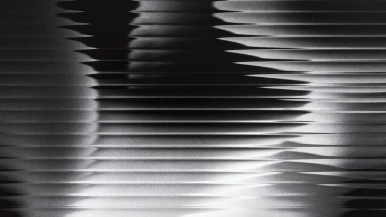</a><br><strong>Silver</strong></td><td width="50%" align="center"><a href="backgrounds/00-nthing-006-5.jpg">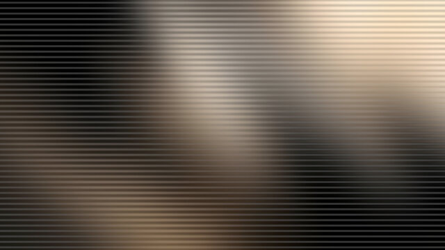</a><br><strong>Sandstone</strong></td></tr>
<tr><td width="50%" align="center"><a href="backgrounds/00-nthing-007-6.jpg">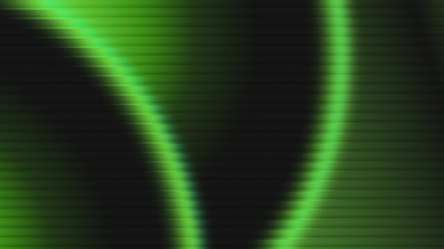</a><br><strong>Green Glyph</strong></td><td width="50%" align="center"><a href="backgrounds/00-nthing-008-7.jpg">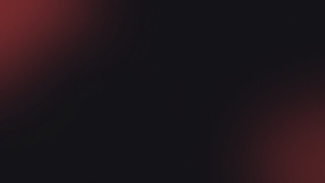</a><br><strong>Diffuse</strong></td></tr>
<tr><td width="50%" align="center"><a href="backgrounds/00-nthing-009-8.jpg">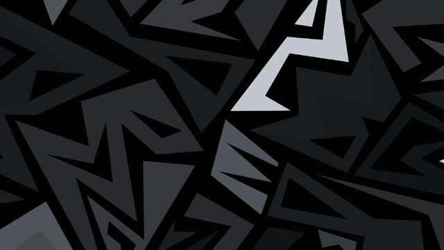</a><br><strong>Angles</strong></td><td width="50%" align="center"><a href="backgrounds/00-nthing-010-9.jpg">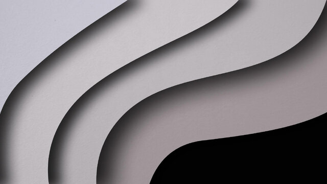</a><br><strong>Fold</strong></td></tr>
</table>

### Additional wallpapers

Three original 3840×2160 wallpaper designs.

<table>
<tr><td width="50%" align="center"><a href="backgrounds/01-glyph.png">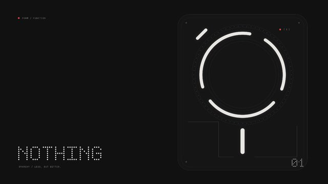</a><br><strong>Glyph</strong><br><sub>Light segments and a charcoal technical drawing</sub></td><td width="50%" align="center"><a href="backgrounds/02-matrix.png">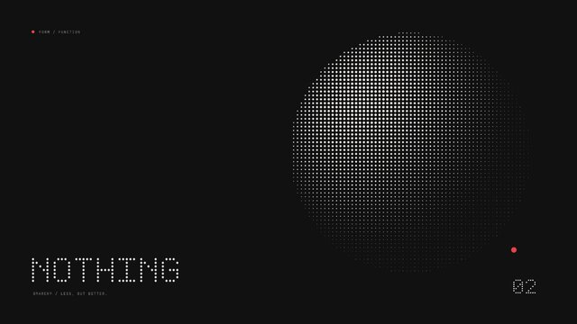</a><br><strong>Matrix</strong><br><sub>A sphere built from dots</sub></td></tr>
<tr><td width="50%" align="center"><a href="backgrounds/03-paper.png">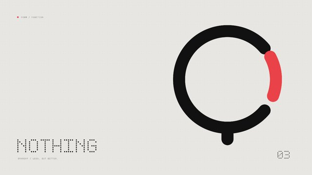</a><br><strong>Paper</strong><br><sub>Black and red on warm white</sub></td><td width="50%"></td></tr>
</table>

## Palette

| Role | Hex |
| --- | --- |
| Background | `#111111` |
| Dark background | `#0c0c0c` |
| Darker background | `#080808` |
| Lighter background | `#1c1c1c` |
| Foreground | `#e8e6e3` |
| Accent | `#e94248` |
| Selection | `#343434` |
| Muted | `#8a8a86` |

Full ANSI palette in [`colors.toml`](colors.toml). Icons are `Yaru-red`. Muted green, yellow, blue, cyan, and magenta keep syntax, diagnostics, and diffs distinguishable. Text, muted text, the accent, and nonblack ANSI colors meet a 4.5:1 contrast ratio against the background.

`shell.toml` styles the bar, launcher, menus, notifications, lock input, and controls. The btop override pairs white graphs with red usage meters. Omarchy generates terminal, Neovim, browser, and Hyprland colors from the palette. This theme targets the current `colors.toml` and Quickshell system and needs no executable theme overrides, install hooks, or extra editor extensions.

The shell and terminal retain your selected font.

## Local installation

From a local checkout:

```sh
mkdir -p ~/.config/omarchy/themes/nothing
cp -R colors.toml shell.toml btop.theme icons.theme keyboard.rgb backgrounds ~/.config/omarchy/themes/nothing/
omarchy theme set nothing
```

## Community gallery

[`preview.png`](preview.png) is a real 16:9 session with a terminal, an editor, and the theme's default wallpaper, captured without a pointer or personal information. The [official submission guide](https://github.com/omacom/omarchy-site#adding-your-theme) describes the gallery entry and image requirements. Export the gallery image with:

```sh
magick preview.png -strip -resize '1200>' -quality 80 nothing.webp
```

For a pull request to `omacom/omarchy-site`, place that image in `assets/themes/nothing.webp` and add an entry to `themes/index.html` alphabetically under **Nothing**, linking to this repository. Gallery inclusion requires maintainer acceptance.

## Credits and license

**[Runixe786](https://github.com/Runixe786)** created **[NThing UI](https://github.com/Runixe786/NThing-UI)**, the source of the ten adapted wallpapers. Credit for those wallpapers belongs to Runixe786 and the original creators identified upstream.

Theme structure and README presentation are inspired by DHH's [Giants](https://github.com/dhh/omarchy-giants-theme), [Zonda Zoom](https://github.com/dhh/omarchy-zonda-zoom-theme), and [Diablo Dreams](https://github.com/dhh/omarchy-diablo-dreams-theme).

Original theme files and the three additional wallpaper designs are [MIT licensed](LICENSE). The ten NThing UI wallpaper adaptations retain their upstream ownership and permissions; this repository's MIT license does not relicense them. This is an independent community theme, unaffiliated with Nothing Technology Limited.
